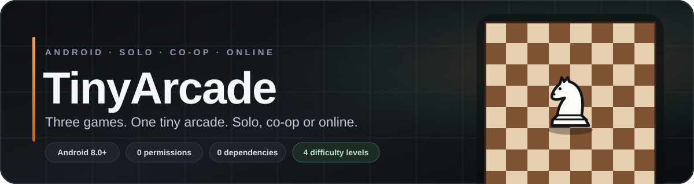

<div align="center">
  

  <br>

  **Chess, Checkers and Power of 4 for Android — solo, local co-op, or online.**

  <sub>No ads · no trackers · no account · no third-party libraries</sub>

  <br><br>

  [](https://github.com/R1y3n/tinyarcade/releases/latest)
  [](https://github.com/R1y3n/tinyarcade/releases)
  [](https://github.com/R1y3n/tinyarcade/stargazers)

  <br>

  
  
  
  
  
</div>

---

TinyArcade is a small arcade built from scratch: a full chess engine, checkers, and Power of 4 in one APK. No Gradle, no AndroidX, no game assets, and no bundled libraries. The whole app is smaller than most launcher icons.

## What's inside

| Game | Highlights |
|:--|:--|
| **Chess** | Complete FIDE rules, four bot levels, PGN sharing, 10 board themes |
| **Checkers** | Mandatory captures, multi-jumps, kings, four bot levels |
| **Power of 4** | Seven columns, six rows, four-in-a-row, four bot levels |

- **Solo** — play offline against the bot, with hints available in every game.
- **Local co-op** — two players share one screen and pass the device.
- **Online multiplayer** — share a six-character room code and play a friend.
- **Same-room rematches** — start another online game without a new code.
- Lossless undo and crash-safe auto-save in every mode.
- Vertical or horizontal screen layout.
- Procedural sound, vector pieces, and a hidden easter egg.

## Install

1. Download the latest APK from **[Releases](https://github.com/R1y3n/tinyarcade/releases/latest)**.
2. Open it on Android 4.0 or newer and allow installation from your browser or file manager.
3. Or install over USB:

```bash
adb install -r TinyArcade-v1.0.2.apk
```

The APK is signed with a local debug key for sideloading and personal use.

## Nightly build

The nightly APK installs alongside stable as a separate app with a purple icon. It tests a much smaller **installed** footprint by disabling ahead-of-time compilation and running the DEX directly from the APK.

- Installed size on the test device: about **149 KB**, versus **6.4 MB** for stable.
- APK size: **229 KB**, because the DEX is stored uncompressed.
- Trade-off: slower startup and engine search. This is an experiment, not a replacement for stable.

**[Download the nightly build](https://github.com/R1y3n/tinyarcade/releases/tag/nightly)**

## Build from source

Requirements:

- JDK 8 or newer (`javac`, `keytool`)
- Android SDK with `build-tools` and at least one `platforms/android-*`
- `zip` on your `PATH`

```bash
git clone https://github.com/R1y3n/tinyarcade.git
cd tinyarcade
export ANDROID_HOME="$HOME/Android/Sdk"

./build.sh stable    # -> tinyarcade.apk
./build.sh nightly   # -> tinyarcade-nightly.apk
```

The script compiles resources with `aapt2`, compiles Java directly against `android.jar`, converts classes with `d8`, packs and aligns the archive, then signs it with `apksigner`. Running it without an argument builds stable.

## Controls

| Action | How |
|:--|:--|
| Select a piece | Tap it — dots show legal moves |
| Capture | Tap the highlighted destination |
| Undo | Toolbar **Undo** |
| Share game | Toolbar **Share PGN** |
| New game | Toolbar **New / Menu** |
| Rematch | Toolbar **New / Menu** after an online game |
| Hint | Toolbar **Hint** in solo games |
| Settings | Gear on the home screen |

## Privacy

Solo and local co-op work fully offline and save on the device. Online multiplayer only exchanges what is needed for the room you are playing in. There are no ads, analytics, trackers, or accounts.

## Under the hood

- 0x88 chess board with iterative-deepening alpha-beta search, transposition tables, quiescence search, and Zobrist hashing.
- One `View` and one `Canvas`; all pieces are vector paths, not bitmaps.
- Audio is synthesized at runtime — there are no sound files in the APK.
- State is written synchronously after every move, so games survive force-stops.
- Stable builds use maximum deflate compression; `resources.arsc` stays stored and 4-byte aligned for Android 11+.

---

<div align="center">

### Built by R1y3n

<a href="https://github.com/R1y3n">
  
</a>

**R1y3n** · System automation

[GitHub](https://github.com/R1y3n) · [Discord](https://discord.gg/gbVnRTn)

<sub>Small by design. Fast by necessity. No frameworks were harmed in the making of this APK.</sub>

</div>
